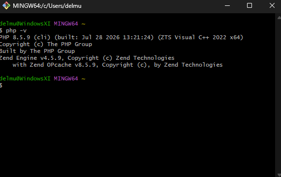
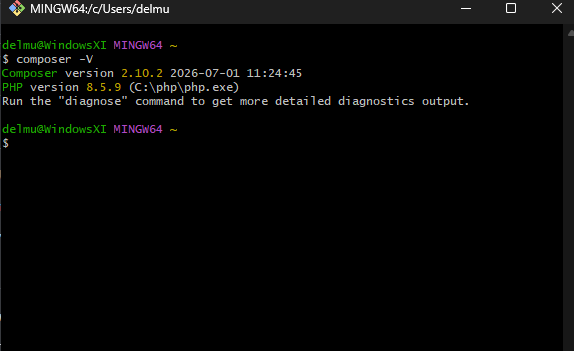
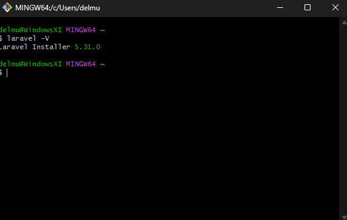
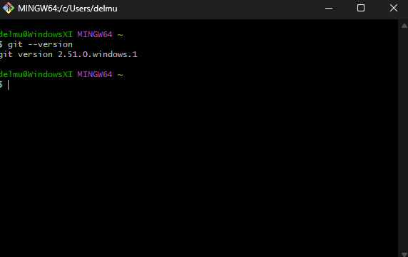
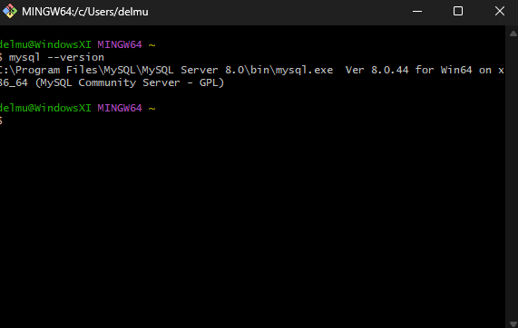
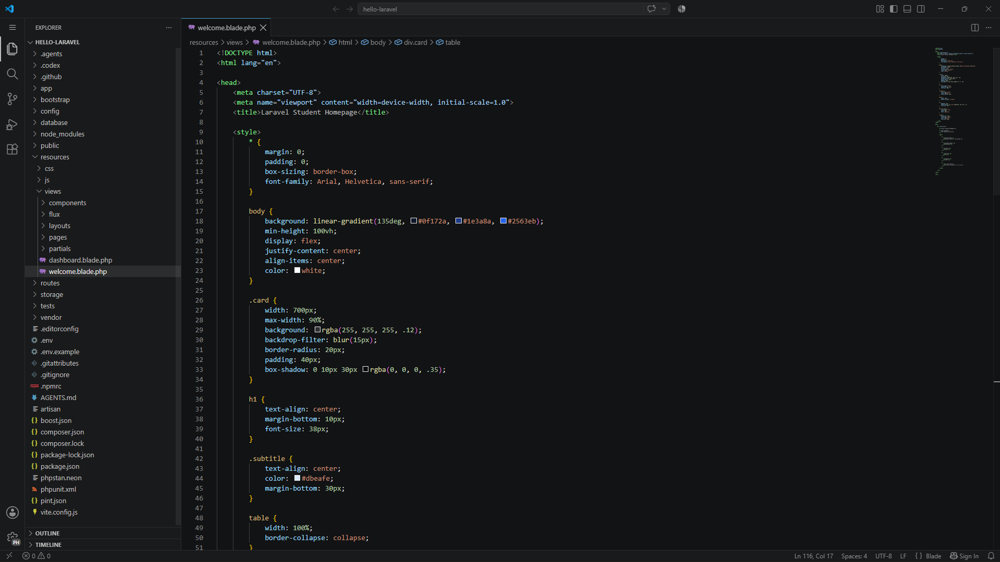
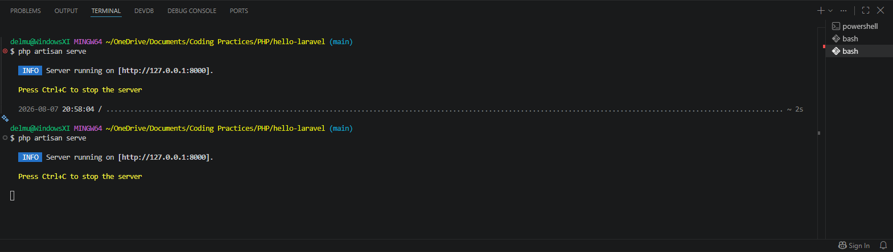

# Client-Server Week 02: Laravel Setup

**Repository:** `client-server-week02-laravel-setup`

**Student Name:** Maverick Denver S. Del Mundo
**Student Number:** 0124 - 0419
**Course:** BSIT
**Section:** 3D
**Subject:** ITST

## 2. Introduction

### Overview of Laravel

Laravel is a modern, open-source PHP framework designed for developing web applications. It provides developers with a structured and organized development environment along with built-in features such as routing, database migrations, authentication, sessions, and Blade templating. Laravel follows the Model-View-Controller (MVC) architectural pattern, which helps separate the application's data, user interface, and application logic.

### Importance of Client-Server Technologies

Client-server technologies are important in modern web development because they allow users to interact with applications through a client, such as a web browser, while the server handles requests, processes data, and communicates with databases. This architecture makes it possible to build dynamic, interactive, and scalable web applications. Understanding how clients and servers communicate is essential for developing reliable web-based systems.

### Purpose of the Project

The purpose of this project is to set up a Laravel development environment and create a basic Laravel web application. The activity provides practical experience in installing and configuring PHP, Composer, Laravel, Git, and Visual Studio Code. It also demonstrates how to create a Laravel project, run it using Laravel's development server, customize a homepage, and manage the project using Git and GitHub. This project serves as an introduction to the tools and workflow commonly used in client-server web application development.

## 3. Objectives

At the end of this activity, the following objectives were achieved:

1. **Install and configure PHP** as the primary server-side scripting environment for Laravel development.

2. **Install and configure Composer** to manage PHP dependencies and Laravel project packages.

3. **Install Laravel** and successfully create a new Laravel project using the Laravel installer.

4. **Set up a Laravel development environment in Visual Studio Code** and become familiar with the basic Laravel project structure.

5. **Configure PHP extensions required by Laravel**, including `fileinfo`, `pdo_sqlite`, and `sqlite3`, to ensure that the Laravel application can properly run and communicate with its database.

6. **Run database migrations** and configure the Laravel application to use SQLite for database storage.

7. **Customize the Laravel homepage** by displaying student information and implementing a modern design and color scheme.

8. **Use Git and GitHub** to initialize, commit, and push the Laravel project to a remote repository for version control and project documentation.

## 4. Development Environment

The project was developed using the following software and development tools:

| Component          | Version               |
| ------------------ | --------------------- |
| Operating System   | Windows 11            |
| PHP                | PHP 8.4               |
| Laravel            | Laravel 13            |
| Composer           | Composer 2.10.2       |
| Git                | Latest Stable Version |
| MySQL              | MySQL 9.7             |
| Visual Studio Code | 1.132                 |

### Version Verification

The installed software versions can be verified using the following commands:

```bash
php -v
php artisan --version
composer -V
git --version
mysql --version
code --version
```
## 5. Installation Steps

### 5.1 Install PHP

PHP was installed manually by downloading the PHP ZIP package for Windows and extracting it to the PHP installation directory. After extraction, PHP was added to the Windows PATH environment variable so that PHP commands could be executed from the terminal.

The installation was verified using:

```bash
php -v
```

**Screenshot:** `screenshots/php-version.png`

---

### 5.2 Install Composer

Composer was installed as the PHP dependency manager for the project. Composer is required to download and manage Laravel's PHP packages and dependencies.

The installation was verified using:

```bash
composer -V
```

**Screenshot:** `screenshots/composer-version.png`

---

### 5.3 Install Laravel

After PHP and Composer were configured, the Laravel installer was used to create the project.

The Laravel installation was verified using:

```bash
php artisan --version
```

**Screenshot:** `screenshots/laravel-version.png`

---

### 5.4 Install and Configure Git

Git was installed and configured for version control. It was used to track changes to the Laravel project and upload the project to GitHub.

The installation was verified using:

```bash
git --version
```

**Screenshot:** `screenshots/git-version.png`

---

### 5.5 Set Up Visual Studio Code

Visual Studio Code was used as the primary code editor for the Laravel project. The `hello-laravel` project folder was opened in Visual Studio Code to manage the Laravel files and write the application code.

**Screenshot:** `screenshots/vscode.png`

---

### 5.6 Create the Laravel Project

The project directory was opened in the VS Code terminal:

```bash
cd "C:\Users\delmu\OneDrive\Documents\Coding Practices\PHP"
```

The Laravel project was then created using:

```bash
laravel new hello-laravel
```

During the installation, the Laravel installer prompted for authentication and Laravel Boost configuration options. The required options were selected to complete the installation.

---

### 5.7 Configure PHP Extensions

During the Laravel installation and application setup, several PHP extensions were required. The necessary PHP extensions were enabled in the `php.ini` configuration file.

The following extensions were verified:

```text
fileinfo
pdo_sqlite
sqlite3
```

These extensions allowed Laravel and Composer to properly handle required packages and SQLite database connections.

---

### 5.8 Run Database Migrations

The Laravel project initially used SQLite as its database connection. After confirming that the SQLite extensions were enabled, the Laravel database migrations were executed using:

```bash
php artisan migrate
```

The migrations successfully created the required database tables.

---

### 5.9 Start the Laravel Development Server

The Laravel development server was started from the project directory using:

```bash
php artisan serve
```

The application was then accessed through:

```text
http://127.0.0.1:8000
```

**Screenshot:** `screenshots/artisan-serve.png`

---

### 5.10 Customize the Homepage

The default Laravel homepage was modified through:

```text
resources/views/welcome.blade.php
```

The homepage was customized to display the following student information:

* Student Name: Maverick Denver S. Del Mundo
* Student Number: 0124 - 0419
* Course: BSIT
* Section: 3D
* Subject: ITST
* Current Date

A modern interface was also implemented using a gradient background, glassmorphism-style card, responsive layout, and modern typography.

**Screenshot:** `screenshots/hello-laravel-homepage.png`

---

### 5.11 Push the Project to GitHub

Git was initialized in the Laravel project directory and the project was committed to version control:

```bash
git init
git add .
git commit -m "Initial Laravel project setup"
```

The local repository was connected to the GitHub repository:

```text
client-server-week02-laravel-setup
```

The project was then pushed to GitHub using:

```bash
git branch -M main
git push -u origin main
```

The screenshots and documentation were subsequently added to the repository.

## 6. Project Structure

Laravel follows an organized project structure that separates application logic, configuration, database files, routes, and user interface resources. The important folders used in this project are described below.

```text
hello-laravel/
│
├── app/
├── bootstrap/
├── config/
├── database/
├── public/
├── resources/
├── routes/
├── storage/
├── tests/
├── .env
├── .gitignore
├── artisan
├── composer.json
└── package.json
```

### `app/`

The `app/` directory contains the main application code. It includes important components such as models, controllers, middleware, and other classes used to implement the application's functionality.

### `routes/`

The `routes/` directory contains the application's route definitions. Routes determine how the application responds when users access specific URLs. The `web.php` file is commonly used for web routes.

### `resources/`

The `resources/` directory contains files used to create the application's user interface. It includes Blade templates, CSS, JavaScript, and other frontend resources. In this project, the customized homepage was created in:

```text
resources/views/welcome.blade.php
```

### `public/`

The `public/` directory contains files that are directly accessible by users through the web server. It serves as the entry point for the Laravel application and can contain publicly accessible assets such as images, CSS, and JavaScript files.

### `config/`

The `config/` directory contains configuration files for different parts of the Laravel application. These files control settings related to the application, database, filesystem, sessions, mail, and other Laravel services.

### `database/`

The `database/` directory contains database-related files, including migrations, seeders, and factories. Migrations are used to create and modify database tables in a structured way. In this project, Laravel migrations were executed to create the required SQLite database tables.

### Other Important Files and Directories

#### `bootstrap/`

The `bootstrap/` directory contains files required to initialize and bootstrap the Laravel framework.

#### `storage/`

The `storage/` directory contains generated files such as logs, cached files, and other application-generated data.

#### `tests/`

The `tests/` directory contains automated tests for the Laravel application.

#### `.env`

The `.env` file contains environment-specific configuration values, such as database and application settings. It should not be committed to a public GitHub repository because it can contain sensitive configuration information.

#### `artisan`

The `artisan` file is Laravel's command-line interface. It allows developers to perform tasks such as starting the development server, running migrations, clearing caches, and creating application components.

For example:

```bash
php artisan serve
```

#### `composer.json`

The `composer.json` file defines the PHP dependencies and packages required by the Laravel application.

#### `package.json`

The `package.json` file contains frontend dependencies and scripts used by the project's JavaScript and CSS tooling.

## 7. Problems Encountered

During the Laravel installation and configuration process, several technical problems were encountered. These issues required troubleshooting and configuration changes before the Laravel application could run successfully.

### 7.1 PHP `fileinfo` Extension Missing

During the creation of the Laravel project, Composer reported that the `fileinfo` PHP extension was missing. The error prevented Composer from resolving and installing some of Laravel's required packages.

The error indicated:

```text
league/mime-type-detection requires ext-fileinfo
```

This occurred because the `fileinfo` extension was not enabled in the PHP configuration.

### 7.2 Composer Could Not Find `composer.json`

When the `composer install` command was executed from the parent PHP directory, Composer displayed an error stating that it could not find a `composer.json` file.

This happened because the command was executed from:

```text
C:\Users\delmu\OneDrive\Documents\Coding Practices\PHP
```

instead of the Laravel project directory:

```text
C:\Users\delmu\OneDrive\Documents\Coding Practices\PHP\hello-laravel
```

The `composer.json` file is located inside the Laravel project directory.

### 7.3 Laravel Installation Configuration Issues

During the Laravel installation process, additional configuration prompts were displayed for authentication features and Laravel Boost. The Boost configuration also produced an error when an invalid empty selection was submitted:

```text
[ERROR] Value "" is invalid
```

The installation had to be completed by selecting a valid configuration option for the Laravel Boost setup.

### 7.4 PHP Extension Configuration

Because PHP was installed manually from a ZIP package, some required PHP extensions were not initially enabled. This required checking the PHP installation, locating the `php.ini` configuration file, and enabling the necessary extensions before Laravel and Composer could operate correctly.

## 8. Solutions

The problems encountered during the Laravel setup were resolved by checking the PHP configuration, working in the correct project directory, and following the required Laravel installation prompts.

### 8.1 Enabling the PHP `fileinfo` Extension

The missing `fileinfo` extension was resolved by locating the PHP configuration file using:

```bash
php --ini
```

The `php.ini` file was opened and the PHP extension configuration was checked. The `fileinfo` extension was enabled, and the PHP terminal environment was restarted to apply the changes.

The extension was then verified using:

```bash
php -m
```

The `fileinfo` extension appeared in the list of enabled PHP modules.

### 8.2 Running Composer in the Correct Directory

The Composer error was resolved by navigating to the Laravel project directory before running Composer commands.

The correct project directory was:

```text
C:\Users\delmu\OneDrive\Documents\Coding Practices\PHP\hello-laravel
```

The project directory was accessed using:

```bash
cd "C:\Users\delmu\OneDrive\Documents\Coding Practices\PHP\hello-laravel"
```

After entering the correct directory, Composer was able to locate the project's `composer.json` file.

### 8.3 Resolving Laravel Boost Configuration

The Laravel Boost configuration error occurred because an empty value was submitted when the installer required a valid selection. The problem was resolved by selecting a valid AI agent configuration during the Laravel Boost setup.

After selecting the required option, the Laravel installation was able to continue successfully.

### 8.4 Configuring PHP Extensions

Because PHP was manually installed from a ZIP package, the required PHP extensions were checked and enabled through the `php.ini` configuration file. The extension directory was also verified to ensure that PHP could locate the required DLL files.

The enabled PHP modules were verified using:

```bash
php -m
```

After confirming that the necessary extensions were active, Laravel and Composer were able to run correctly.

### 8.5 Verifying the Laravel Application

After resolving the installation and configuration issues, the Laravel application was tested using:

```bash
php artisan serve
```

The application was successfully accessed through:

```text
http://127.0.0.1:8000
```

The customized Laravel homepage was then displayed successfully in the browser.
## 9. Screenshots

The following screenshots document the installation, configuration, development environment, and completed Laravel application.

### 9.1 PHP Version

This screenshot shows the installed PHP version used for the Laravel development environment.



---

### 9.2 Composer Version

This screenshot shows the installed Composer version used to manage PHP and Laravel dependencies.



---

### 9.3 Laravel Version

This screenshot shows the Laravel framework version installed for the project.



---

### 9.4 Git Version

This screenshot shows the installed Git version used for version control and uploading the project to GitHub.



---

### 9.5 MySQL Version

This screenshot shows the MySQL version installed in the development environment.



---

### 9.6 Visual Studio Code

This screenshot shows the Laravel project opened and managed using Visual Studio Code.



---

### 9.7 Laravel Artisan Development Server

This screenshot shows the Laravel development server running successfully using the `php artisan serve` command.



---

### 9.8 Customized Laravel Homepage

This screenshot shows the completed Laravel homepage containing the student's information and the implemented modern design and color scheme.


## 10. Reflection

This activity helped me understand how Laravel and the different tools used in web development work together. Before doing this activity, I knew that PHP was used for web development, but I did not fully understand how PHP, Composer, Laravel, Git, GitHub, and Visual Studio Code fit into the development process. After completing the setup, I now have a better idea of how these tools are used to create and manage a web application.

One of the things I learned was how to install Laravel and create a project using the Laravel installer. I also learned how important Composer is because it manages the packages and dependencies that Laravel needs. Using Visual Studio Code also made it easier to organize and edit the project files. I became more familiar with folders such as `app`, `routes`, `resources`, `database`, and `public`, and I learned that each folder has a specific purpose in a Laravel application.

The installation was not completely straightforward. I encountered several problems along the way, especially with PHP extensions. Composer initially showed an error because the `fileinfo` extension was missing. Since I installed PHP manually from a ZIP file, I had to check the PHP configuration and make sure the required extensions were enabled. I also made the mistake of running `composer install` in the wrong directory, which resulted in an error because Composer could not find the `composer.json` file. There was also an error during the Laravel Boost setup because an empty option was submitted. These problems were frustrating at first, but they helped me learn how to read error messages and troubleshoot problems instead of simply starting the installation over.

I also learned why Laravel is useful for client-server development. Laravel provides many built-in features that make developing web applications easier and more organized. Instead of creating everything from scratch, developers can use Laravel's routing, database migrations, Blade templates, and other features to build applications more efficiently.

Overall, this activity gave me practical experience that I can use in future projects. I now feel more comfortable setting up a Laravel environment, working with its project structure, troubleshooting basic configuration problems, and using Git and GitHub to manage my code. These skills will be useful as I start building larger and more complete web applications in the future.

11. References

Composer. (n.d.). Composer documentation. https://getcomposer.org/doc/

Git. (n.d.). Git documentation. https://git-scm.com/docs

Laravel. (n.d.). Installation. https://laravel.com/docs/13.x/installation

Microsoft. (n.d.). Visual Studio Code documentation. https://code.visualstudio.com/docs

MySQL. (n.d.). MySQL 9.0 reference manual. https://dev.mysql.com/doc/refman/9.0/en/

PHP Documentation Group. (n.d.). PHP manual. https://www.php.net/manual/en/
